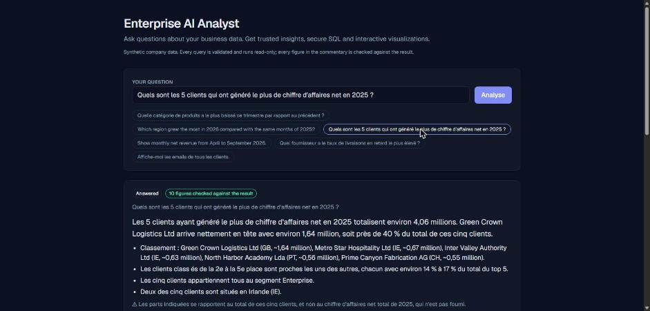
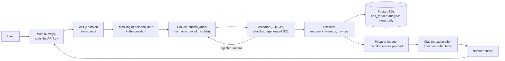

# Enterprise AI Analyst

**Ask questions about your business data. Get trusted insights, secure SQL and interactive visualizations.**

A business question such as *"Which product category dropped the most this quarter?"*
becomes a SQL query, which is validated, run read-only on a company database, and returned
with a chart, the table, a written explanation **in which every figure is checked against
the result**, and the full trace of how the answer was built.



It is not a Text-to-SQL chatbot: the model never touches the database, never defines a
business metric, never sees personal data, and never gets a number past the checks.
The data is synthetic; the controls are the ones real data would need.

## What makes the answers trustworthy

| Risk | What the system does | Proof |
|---|---|---|
| Destructive or exfiltrating SQL (prompt injection, confused model) | An allowlist validator (SQLGlot, whole tree) runs regenerated SQL; a PostgreSQL role that can only `SELECT` curated views; a read-only transaction with timeouts | 54 attacks, 29 stopped by the database even with the validator skipped ([security.md](docs/security.md)) |
| The model improvises what "revenue" means | Business definitions are SQL views, documented and checked against the database | Every metric equals a value computed by hand ([semantic-layer.md](docs/semantic-layer.md)) |
| A query that runs but answers wrong | Evaluation by result comparison against hand-written reference SQL, with a held-out split | 53 questions, 8 injected anomalies, 7 to refuse ([evaluation.md](docs/evaluation.md)) |
| A fluent sentence with a wrong figure | Code computes the facts; every number in the explanation is checked, or the commentary is withheld | 25/25 then 23/25 explanations verified, never an unchecked figure shown ([ADR 0010](docs/adr/0010-explanations-with-checked-numbers.md)) |
| Personal data sent to the LLM provider | Column classification, column lineage, pseudonymised payloads, masking of identifiers typed in questions | A test on the real data: no customer name reaches the provider ([privacy.md](docs/privacy.md)) |
| A public demo draining the budget | Limits per client and concurrency, a daily budget in dollars, a token ceiling per explanation | Tested, and the production stack is started by the CI ([deployment.md](docs/deployment.md)) |

## Architecture



The LLM proposes, the backend verifies, the database enforces permissions.
Details: [architecture.md](docs/architecture.md) and 11 [architecture decision records](docs/adr/).

## In numbers

- **Accuracy**: 53/53 questions right with Claude Opus 5.5, and with Sonnet 5.5 and Opus
  at low effort; the set is saturated, so cost and latency now decide
  ([results](backend/eval/results/README.md)).
- **Latency**: the result is streamed after about 9 s, the checked explanation follows.
- **Cost**: $0.006 to $0.015 per question without explanation, about $0.035 with it, at
  most about $0.13 since the explanation's token ceiling.
- **Tests**: 295 unit tests, 168 database tests, 13 frontend tests, 6 live tests run by
  hand; the CI also builds and starts the production stack.
- **Found by measuring**: a view that made a natural query take 31 s (now 1.6 s), a
  runaway explanation ($0.34, now bounded), a prompt rule confirmed on held-out questions.
  The full list: [case study](docs/case-study.md).

## Stack

Python 3.12, FastAPI, Pydantic, PostgreSQL 16, SQLAlchemy and Alembic, psycopg 3,
SQLGlot, the Anthropic SDK (Claude, tool calling with strict schemas, prompt caching,
server-side fallbacks), Next.js 16, TypeScript, Tailwind 4, Recharts, Docker Compose,
Caddy, GitHub Actions. No LangChain, no vector database, no queue: each dependency
answers a measured need ([ADR 0001](docs/adr/0001-scope-and-guiding-principles.md)).

## Documentation

- [Case study: the problems found and how they were fixed](docs/case-study.md)
- [Architecture and roadmap](docs/architecture.md)
- [Data model and injected anomalies](docs/data-model.md)
- [Semantic layer: business definitions](docs/semantic-layer.md)
- [Security of generated SQL: layers, attack corpus, residual risks](docs/security.md)
- [Privacy by design: data flows, pseudonymisation, re-identification risks](docs/privacy.md)
- [Evaluation: method](docs/evaluation.md) and [results](backend/eval/results/README.md)
- [Deployment: the Docker stack, limits, backups](docs/deployment.md)
- [Architecture decision records](docs/adr/)

## Run locally

Requirements: Python 3.12, [uv](https://docs.astral.sh/uv/), PostgreSQL 16, Node.js 22.

```
cd backend
uv sync
cp .env.example .env        # then set the passwords and ANTHROPIC_API_KEY
# as the PostgreSQL superuser, once: the roles and the eaa / eaa_test databases
psql -v ON_ERROR_STOP=1 -v owner_password=... -f scripts/create_local_databases.sql
psql -v ON_ERROR_STOP=1 -v reader_password=... -v app_password=... -f scripts/create_roles.sql
uv run alembic upgrade head
uv run python -m eaa.synthetic --scale small --seed 42
uv run python -m eaa.execution "SELECT region, COUNT(*) FROM customers GROUP BY 1"   # no LLM
uv run uvicorn eaa.main:create_app --factory --reload
```

```
cd frontend
npm install
API_URL=http://127.0.0.1:8000 npm run dev     # add API_KEY=... if the backend has one
```

Open http://localhost:3000, ask a question, open the **AI Analysis Trace**, and see the
service metrics on http://localhost:3000/metrics. The API is documented on
http://127.0.0.1:8000/docs (`POST /analyses`, `POST /analyses/stream`).

To run the whole stack as in production: [docs/deployment.md](docs/deployment.md).

## Checks

```
cd backend
uv run ruff format --check . && uv run ruff check . && uv run mypy
uv run pytest                        # unit tests, the LLM is simulated
uv run pytest -m "db and not live"   # database tests, against a disposable *_test database
uv run pytest -m live -s             # real Claude calls (about $0.10): only on purpose
uv run python -m eaa.evaluation run --label my-run --split dev   # the evaluation (about $0.40)
cd ../frontend && npm run lint && npm run typecheck && npm test
```

## Limits, stated plainly

- One shared API key, no user accounts: fine for synthetic data, not for real data
  ([deployment.md](docs/deployment.md#before-connecting-real-data)).
- The question set is saturated; harder questions are the next step for the evaluation.
- Explanation quality varies from run to run; the checks guarantee the figures, not the
  wording.
- Names of people typed into a question are not detected (identifiers with a format are).

## License

MIT, see [LICENSE](LICENSE). All data in this project is synthetic.
